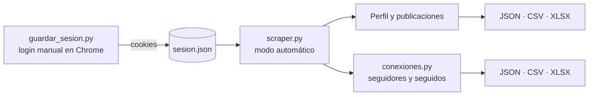

# 📸 Scraping de Instagram con Python

**Extracción, limpieza y exportación de los datos visibles de tu propio perfil de Instagram mediante automatización de navegador.**


---

## Tabla de contenidos

- [Descripción](#descripción)
- [Características](#características)
- [¿Cómo funciona?](#cómo-funciona)
- [Tecnologías](#tecnologías)
- [Requisitos](#requisitos)
- [Instalación](#instalación)
- [Configuración](#configuración)
- [Uso](#uso)
- [Resultados generados](#resultados-generados)
- [Estructura del proyecto](#estructura-del-proyecto)
- [Sesión y cookies](#sesión-y-cookies)
- [Seguridad y privacidad](#seguridad-y-privacidad)
- [Uso responsable](#uso-responsable)
- [Solución de problemas](#solución-de-problemas)
- [Limitaciones conocidas](#limitaciones-conocidas)
- [Hoja de ruta](#hoja-de-ruta)
- [Autor y licencia](#autor-y-licencia)

---

## Descripción

Proyecto académico desarrollado en **Python** que automatiza un navegador Chrome con **Playwright** para recopilar y organizar la información visible de un perfil de Instagram: datos del perfil, publicaciones y reels, y las listas de **seguidores** y **seguidos**.

Los datos se leen de la propia página (no se usa ninguna API), se limpian con expresiones regulares y **pandas**, y se exportan a **JSON**, **CSV** y **Excel**, listos para analizar.

El inicio de sesión se hace **una sola vez y de forma manual** en un Chrome real; el proyecto guarda únicamente las cookies de esa sesión y **nunca almacena ni procesa tu contraseña**.

## Características

- 🔐 **Sesión reutilizable:** inicias sesión una vez y los scripts reutilizan las cookies guardadas.
- 👤 **Perfil:** nombre, biografía y contadores de publicaciones, seguidores y seguidos, convertidos a números reales (`1,2 K` → `1200`).
- 🖼️ **Publicaciones y reels:** fecha y hora en zona horaria de Ecuador, likes, comentarios, descripción, enlace e imagen.
- 👥 **Seguidores y seguidos:** extracción desde los modales de Instagram con scroll automático.
- 🔁 **Cruce de listas:** mutuos, quién te sigue y no sigues, y **quién no te sigue de vuelta**.
- ✅ **Control de calidad:** el resumen indica si cada lista quedó completa y si el cruce es confiable.
- 📦 **Exportación múltiple:** Excel (varias hojas con formato), JSON y CSV (compatible con tildes y ñ en Excel).
- 🛡️ **Tolerancia a fallos:** si una publicación falla, el proceso continúa y el error queda registrado.
- 🧪 **Modo de prueba:** límites configurables para probar con pocas publicaciones o usuarios.

## ¿Cómo funciona?



1. **Paso manual (una vez):** `guardar_sesion.py` abre tu Google Chrome con un perfil propio del proyecto. Inicias sesión con normalidad y el script copia las cookies a `sesion.json`.
2. **Paso automático:** `scraper.py` abre Chrome con Playwright, carga esas cookies y navega por el perfil sin intervención: hace scroll, visita cada publicación y abre las listas de seguidores y seguidos.
3. **Limpieza y exportación:** los textos se convierten en datos estructurados y se guardan en archivos listos para usar.

> El navegador se ejecuta **en modo visible** (`headless=False`), no en segundo plano. Esto reduce las verificaciones de Instagram y permite resolver un captcha si aparece.

## Tecnologías

| Tecnología | Uso |
|---|---|
| [Python](https://www.python.org/) | Lenguaje principal |
| [Playwright](https://playwright.dev/python/) | Automatización del navegador |
| [BeautifulSoup4](https://www.crummy.com/software/BeautifulSoup/) + [lxml](https://lxml.de/) | Lectura del HTML |
| [pandas](https://pandas.pydata.org/) | Tablas, fechas y cruce de listas |
| [openpyxl](https://openpyxl.readthedocs.io/) | Exportación a Excel |
| Git y GitHub | Control de versiones |

## Requisitos

- **Python 3.11** o superior.
- **Google Chrome** instalado (recomendado). Si no está, el proyecto usa el Chromium que descarga Playwright.
- Una cuenta de Instagram **propia**.
- Windows, macOS o Linux.

## Instalación

**1. Clonar el repositorio**

```bash
git clone https://github.com/Alex280201/scraping-instagram.git
cd scraping-instagram
```

**2. Crear y activar un entorno virtual**

```bash
python -m venv venv
```

| Sistema | Comando de activación |
|---|---|
| Windows (PowerShell) | `.\venv\Scripts\Activate.ps1` |
| Windows (CMD) | `venv\Scripts\activate.bat` |
| macOS / Linux | `source venv/bin/activate` |

**3. Instalar las dependencias**

```bash
pip install -r requirements.txt
```

**4. Instalar el navegador de Playwright**

```bash
playwright install chromium
```

**5. (Opcional) Comprobar la instalación**

```bash
python prueba.py
```

Debe abrirse una ventana, cargar Instagram e imprimir el título de la página.

## Configuración

Edita las constantes al inicio de los scripts según tus necesidades.

**`scraper.py`**

| Constante | Valor por defecto | Descripción |
|---|---|---|
| `USUARIO` | `"alexchicango"` | Nombre de usuario del perfil a analizar. **Cámbialo por tu propia cuenta** |
| `EXTRAER_CONEXIONES` | `True` | Extrae también seguidores y seguidos |
| `LIMITE` | `None` | `None` = todas las publicaciones; un número = solo esas (para pruebas) |
| `MAX_ENLACES` | `500` | Tope de seguridad al hacer scroll en el perfil |
| `ZONA` | `America/Guayaquil` | Zona horaria de las fechas exportadas |

**`conexiones.py`**

| Constante | Valor por defecto | Descripción |
|---|---|---|
| `LIMITE_CONEXIONES` | `None` | Máximo de usuarios por lista (para pruebas) |
| `MAX_SCROLLS` | `300` | Máximo de scrolls por lista |
| `MAX_SIN_PROGRESO` | `6` | Scrolls consecutivos sin usuarios nuevos antes de detenerse |

> Los scripts de etapas separadas (`perfil.py`, `scrape_perfil.py`) tienen su propia constante `USUARIO`.

## Uso

Con el entorno virtual activado y desde la raíz del proyecto:

### 1. Guardar la sesión (solo la primera vez o cuando caduque)

```bash
python guardar_sesion.py
```

1. Se abre una ventana de Chrome en la página de inicio de sesión de Instagram.
2. Inicia sesión con tu cuenta y completa cualquier verificación que te pida.
3. Cuando veas el **feed**, vuelve a la terminal y pulsa **ENTER**.
4. Se crea el archivo `sesion.json`.

### 2. Ejecutar el scraper completo

```bash
python scraper.py
```

Extrae el perfil, todas las publicaciones y, si `EXTRAER_CONEXIONES = True`, los seguidores y seguidos. **No cierres la ventana de Chrome** mientras trabaja. El tiempo depende del número de publicaciones y seguidores porque el script hace pausas aleatorias entre acciones.

### 3. Solo seguidores y seguidos (opcional)

```bash
python conexiones.py
```

### Pipeline por etapas (opcional)

Para ejecutar cada fase por separado y conservar los archivos intermedios:

```bash
python scrape_perfil.py          # → datos_perfil.json
python scrape_publicaciones.py   # → datos_completos.json y publicaciones.csv
python depurar_datos.py          # → perfil_limpio.json y publicaciones_limpias.csv/.xlsx
```

## Resultados generados

| Archivo | Contenido |
|---|---|
| `instagram_publicaciones.xlsx` | Hojas **Perfil** y **Publicaciones** |
| `instagram_datos.json` | Perfil, resumen y publicaciones |
| `instagram_publicaciones.csv` | Publicaciones en CSV |
| `instagram_conexiones.xlsx` | Hojas **Resumen**, **Seguidores**, **Seguidos** y **No me siguen de vuelta** |
| `instagram_conexiones.json` | Resumen y ambas listas |
| `instagram_seguidores.csv` / `instagram_seguidos.csv` | Una lista por archivo |

**Columnas de las publicaciones:** `n`, `codigo`, `tipo` (publicación o reel), `fecha`, `hora`, `anio`, `likes`, `comentarios`, `descripcion`, `tiene_descripcion`, `url`, `imagen`.

**Resumen de conexiones:** totales declarados y extraídos, si cada lista está completa, mutuos, `solo_me_siguen`, `solo_los_sigo` y `cruce_confiable`. Si una lista queda incompleta, el resumen lo marca y el cruce **no debe considerarse confiable**.

Todos los archivos generados se guardan **localmente** y están excluidos del repositorio mediante `.gitignore`.

## Estructura del proyecto

```
scraping-instagram/
├── guardar_sesion.py         # Login manual en Chrome real → crea sesion.json
├── sesion_util.py            # Lanza el navegador y abre Instagram con la sesión
├── scraper.py                # Scraper principal: perfil + publicaciones + conexiones
├── conexiones.py             # Seguidores, seguidos y cruce de listas
│
├── scrape_perfil.py          # Etapa 1: perfil y enlaces        (pipeline por etapas)
├── scrape_publicaciones.py   # Etapa 2: detalle de publicaciones (pipeline por etapas)
├── depurar_datos.py          # Etapa 3: limpieza y exportación   (pipeline por etapas)
│
├── perfil.py                 # Utilidad: guarda el HTML del perfil para depurar
├── prueba.py                 # Prueba rápida de la instalación
│
├── requirements.txt          # Dependencias con versiones fijadas
├── .gitignore                # Excluye sesión, perfil de Chrome y datos generados
└── README.md
```

## Sesión y cookies

Instagram identifica tu sesión con una cookie llamada **`sessionid`**. El proyecto:

1. Hace que inicies sesión tú, en un Chrome normal, para evitar bloqueos del login automatizado.
2. Se conecta a ese Chrome (protocolo CDP) y guarda las cookies en `sesion.json` con `storage_state` de Playwright.
3. En cada ejecución crea un contexto nuevo con esas cookies. Si Instagram redirige al login, el programa avisa de que la sesión caducó y basta repetir el paso 1.

La sesión puede dejar de ser válida si caduca la cookie, cierras sesión, cambias la contraseña o Instagram solicita una verificación.

## Seguridad y privacidad

> ⚠️ **`sesion.json` equivale a tu contraseña.** Quien lo tenga puede entrar a tu cuenta sin usuario, sin contraseña y sin segundo factor.

- **Nunca** subas a GitHub `sesion.json`, la carpeta `.chrome_perfil/` ni los datos exportados. El `.gitignore` ya los excluye.
- Comprueba que no se versionaron: `git ls-files | grep -i sesion` no debe devolver nada.
- Si alguna vez se subieron por error, **revoca la sesión** desde Instagram (Centro de cuentas → Contraseña y seguridad → Dónde iniciaste sesión) y cambia la contraseña. Borrar el archivo del repositorio no es suficiente.
- No compartas capturas de las cookies ni uses extensiones de terceros para exportarlas.
- Los datos exportados incluyen nombres de usuario de otras personas: trátalos con cuidado y no los publiques.

## Uso responsable

- Utiliza el proyecto **únicamente con fines educativos** y sobre **tu propia cuenta**, o con autorización expresa para acceder a la información.
- La recolección automatizada puede ir en contra de las condiciones de uso de Instagram y puede derivar en avisos, límites temporales o el cierre de la sesión. Úsalo con moderación y respeta los límites de acceso de la plataforma.
- Si solo necesitas tus listas de seguidores y seguidos, Instagram permite **descargar tu información** desde el Centro de cuentas, sin automatización.
- El autor no se responsabiliza del uso indebido de este código.

## Solución de problemas

| Problema | Solución |
|---|---|
| `No existe sesion.json` | Ejecuta `python guardar_sesion.py` desde la raíz del proyecto |
| `La sesión de Instagram caducó` | Repite `python guardar_sesion.py` |
| `No encontré Google Chrome` | Instala Chrome o añade su ruta a `RUTAS_CHROME` en `guardar_sesion.py` |
| Error al conectar con el puerto 9222 | Cierra todas las ventanas de Chrome abiertas con el perfil `.chrome_perfil` y vuelve a ejecutar |
| Pantalla en blanco o captcha al iniciar sesión | Inicia sesión únicamente mediante `guardar_sesion.py` |
| `No se pudo abrir el modal de seguidores` | Revisa `debug_followers.png` y `debug_followers.html`, generados automáticamente |
| Listas incompletas en el resumen | Aumenta `MAX_SIN_PROGRESO` o `MAX_SCROLLS` y repite; el cruce no es fiable hasta que ambas estén completas |
| `ModuleNotFoundError` | Ejecuta `pip install -r requirements.txt` con el entorno virtual activo |
| `PermissionError` al guardar un `.xlsx` | Cierra el archivo en Excel y vuelve a ejecutar |

## Limitaciones conocidas

- Depende de la estructura visual de Instagram, que puede cambiar sin previo aviso y romper algunos selectores.
- Los textos de los botones y contadores se interpretan en **español e inglés**; otros idiomas pueden dar valores vacíos.
- Si una cuenta oculta los likes, esa columna quedará vacía.
- Instagram puede no mostrar la lista completa de seguidores o seguidos en el modal; en ese caso el resumen lo indica.
- El enlace de imagen exportado suele ser temporal.
- No se ejecuta en modo *headless* (sin ventana): se usa siempre un navegador visible.

## Hoja de ruta

- [ ] Centralizar la configuración (`USUARIO`, zona horaria, nombres de archivo) en un único módulo.
- [ ] Guardar el progreso a medida que se extrae para poder reanudar tras una interrupción.
- [ ] Renovar `sesion.json` al terminar cada ejecución.
- [ ] Añadir pruebas automáticas (`pytest`) para las funciones de limpieza.
- [ ] Sustituir `print` por el módulo `logging`.
- [ ] Opción configurable de modo *headless*.
- [ ] Añadir un archivo `LICENSE`.

## Autor y licencia

Proyecto académico de scraping con Python desarrollado por [Alex280201](https://github.com/Alex280201).

Este repositorio aún no incluye un archivo `LICENSE`. Si lo vas a publicar, añade uno (por ejemplo, MIT) para dejar claros los términos de uso.
